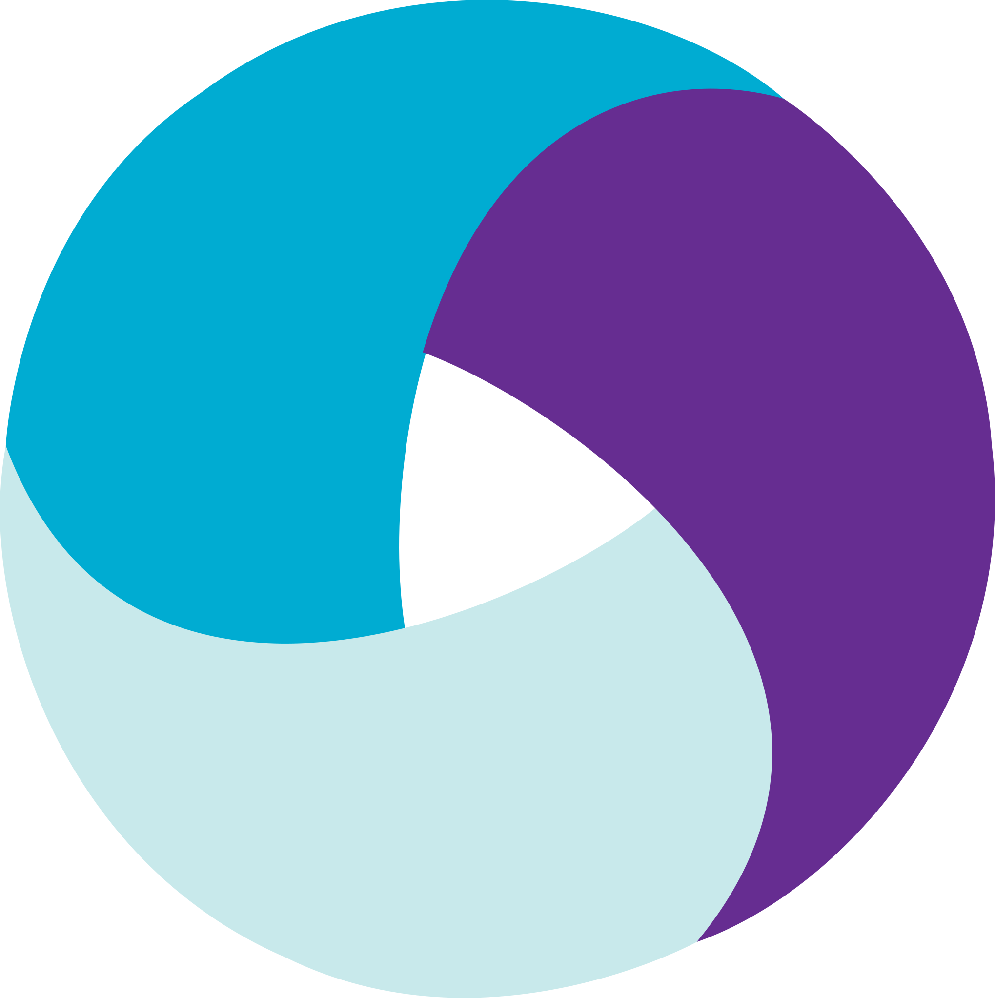
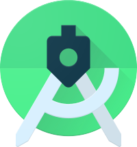

<h1 align="center">Мобильные автотесты для <a href="https://www.wikipedia.org">Wikipedia</a></h1>

<p align="center">
  <a href="https://www.wikipedia.org"></a>
</p>

Мобильная часть дипломного проекта QA.GURU. Тесты проверяют поиск в Android-приложении [Wikipedia](https://www.wikipedia.org) и запускаются двумя способами: на эмуляторе Android Studio у себя на компьютере и на реальном устройстве в [BrowserStack](https://www.browserstack.com/app-automate). UI- и API-тесты лежат в репозитории [AVIASALESDEGREE](https://github.com/H1ghOctane/AVIASALESDEGREE).

## Содержание

- [Стек](#стек)
- [Что проверяют тесты](#что-проверяют-тесты)
- [Структура проекта](#структура-проекта)
- [Подготовка к локальному запуску](#подготовка-к-локальному-запуску)
- [Запуск](#запуск)
- [Сборка в Jenkins](#сборка-в-jenkins)
- [Отчёт Allure](#отчёт-allure)
- [Видео прохождения теста](#видео-прохождения-теста)

## Стек

<p align="center">
  
  
  
  
  
  
  
  
  
  
</p>

| Назначение | Инструмент | Версия |
| --- | --- | --- |
| Язык | Java | 17 |
| Сборка | Gradle | 8.13 |
| Тестовый фреймворк | JUnit 5 | 5.13.4 |
| Работа с приложением | Selenide Appium | 7.18.1 |
| Драйвер | Appium Java Client | 9.5.0 |
| Конфигурация | Owner | 1.0.12 |
| Отчёты | Allure Report | 2.46.1 |
| Локальный запуск | Appium 2, эмулятор Android Studio | |
| Удалённый запуск | BrowserStack App Automate | |
| CI | Jenkins | |

## Что проверяют тесты

Все тесты в классе `WikipediaSearchTest`:

- поиск по запросам «Appium», «Selenium» и «Java» находит статьи (параметризованный тест);
- в результатах по запросу «Appium» есть статья с таким названием;
- статья «Appium» открывается из результатов, и в ней правильный заголовок;
- после очистки строки поиска список результатов пустеет.

## Структура проекта

```
src/test
├── java
│   ├── config    два конфига Owner: LocalConfig и BrowserstackConfig
│   ├── drivers   LocalDriver (эмулятор) и BrowserstackDriver
│   ├── helpers   скриншот и видео из BrowserStack в Allure
│   ├── screens   экраны приложения: главный, поиск, статья
│   └── tests     TestBase и тесты
└── resources
    └── config    local.properties и browserstack.properties
```

Тесты работают с приложением только через классы экранов (Screen Object). Способ запуска выбирается параметром `deviceHost`, и каждому способу соответствует свой конфиг.

## Подготовка к локальному запуску

1. В Android Studio открой Device Manager и создай эмулятор Pixel с Android 11 (API 30). Приложение собрано в 2017 году, на новых версиях Android оно может не установиться.
2. Установи Appium 2 и драйвер UiAutomator2:

   ```bash
   npm i -g appium
   appium driver install uiautomator2
   ```

3. Положи APK приложения в `src/test/resources/apps/WikipediaSample.apk`. Это демо-сборка Wikipedia из документации BrowserStack App Automate, та же, что загружена в BrowserStack. В репозиторий APK не коммитится.
4. Запусти эмулятор, затем в отдельном терминале команду `appium`. Команда `adb devices` должна показать эмулятор. Если его имя отличается от `emulator-5554`, поправь `local.deviceName` в `src/test/resources/config/local.properties`.

## Запуск

На эмуляторе:

```bash
./gradlew clean test -DdeviceHost=local
```

В BrowserStack:

```bash
./gradlew clean test -DdeviceHost=browserstack
```

Без параметра `deviceHost` тесты запускаются на эмуляторе.

Для BrowserStack нужны логин и ключ доступа. Положи их в файл `browserstack.properties` в домашней папке, вне репозитория:

```properties
bs.username=логин
bs.accessKey=ключ
```

В `src/test/resources/config/browserstack.properties` лежат только устройство, версия Android и ссылка на загруженное приложение, секретов там нет.

| Параметр | Что задаёт | По умолчанию |
| --- | --- | --- |
| `deviceHost` | где запускать: `local` или `browserstack` | `local` |
| `local.deviceName` | имя эмулятора из `adb devices` | `emulator-5554` |
| `local.platformVersion` | версия Android эмулятора | `11.0` |
| `local.appiumUrl` | адрес Appium | `http://127.0.0.1:4723` |
| `bs.deviceName` | устройство в BrowserStack | `Samsung Galaxy S22 Ultra` |
| `bs.osVersion` | версия Android в BrowserStack | `12.0` |

## Сборка в [Jenkins](https://jenkins.qa.guru/job/MOBILE_H1GHT0CTANE/)

Сборка запускает тесты в BrowserStack. Логин и ключ передаются параметрами `BROWSERSTACK_USERNAME` и `BROWSERSTACK_ACCESS_KEY` и в лог сборки не попадают.


## [Отчёт Allure](https://jenkins.qa.guru/job/MOBILE_H1GHT0CTANE/lastCompletedBuild/allure/)

У каждого теста в отчёте есть шаги, скриншот последнего экрана и видео из BrowserStack.


## Видео прохождения теста

Тест открытия статьи в BrowserStack.

<p align="center">
  
</p>
